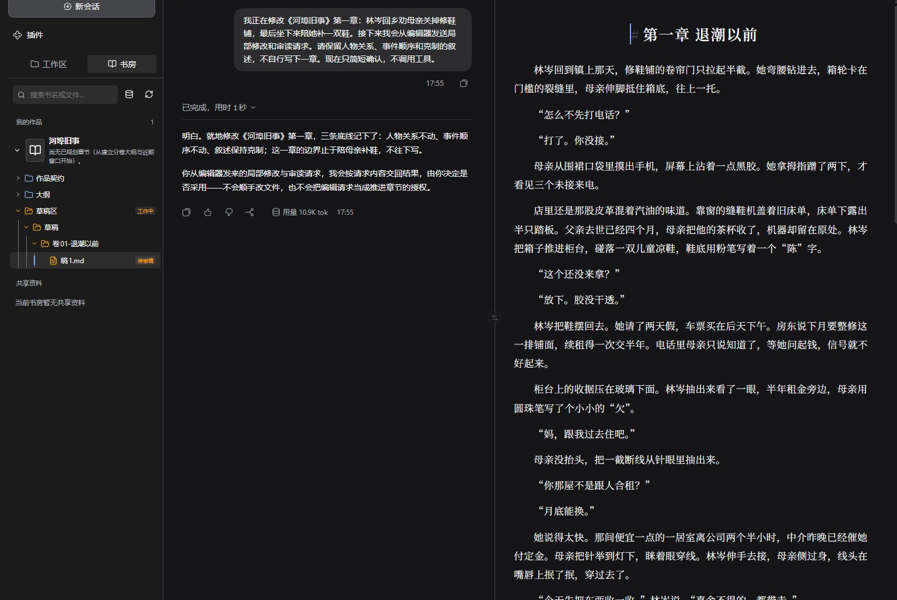
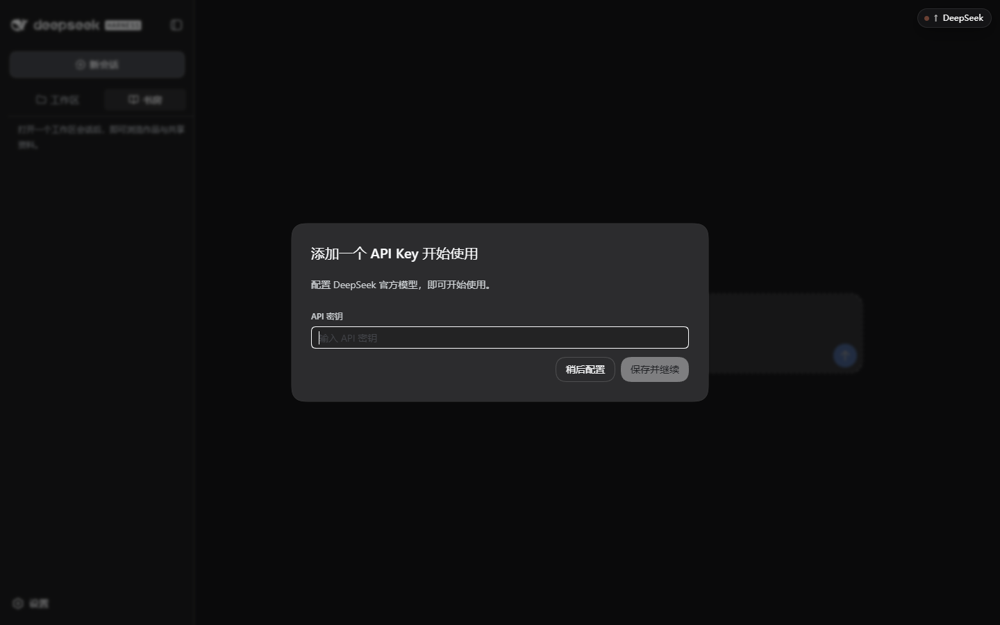
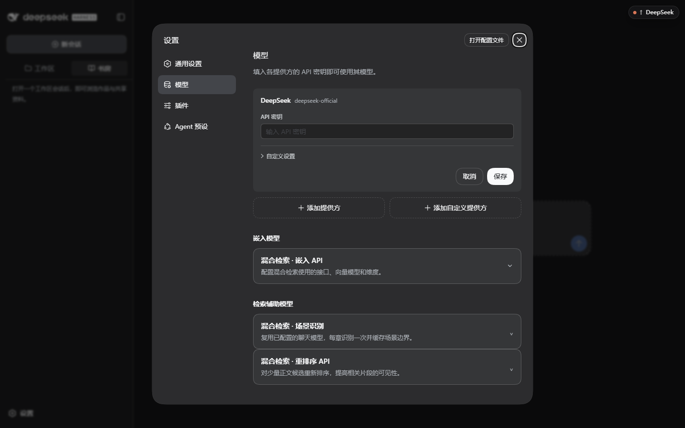
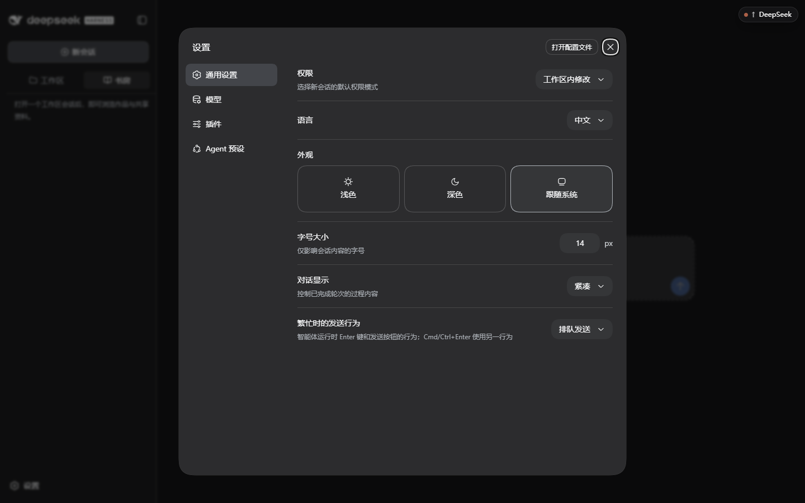
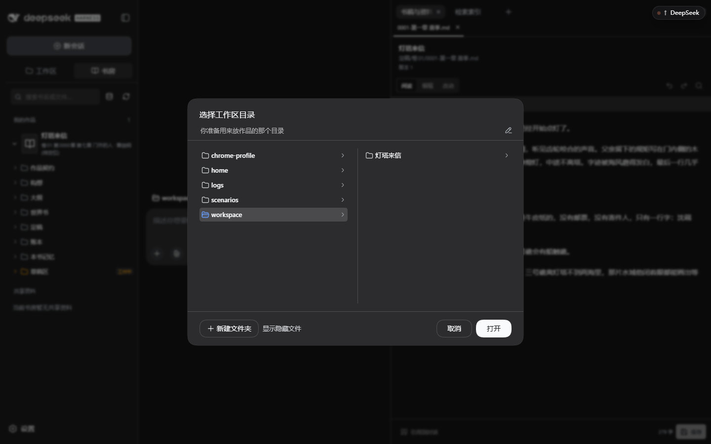
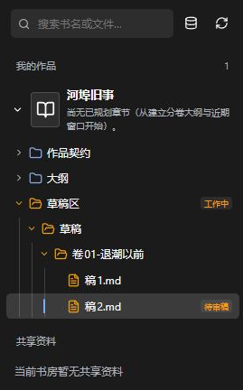
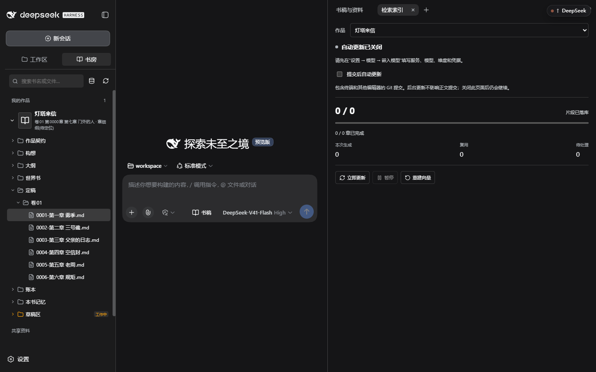
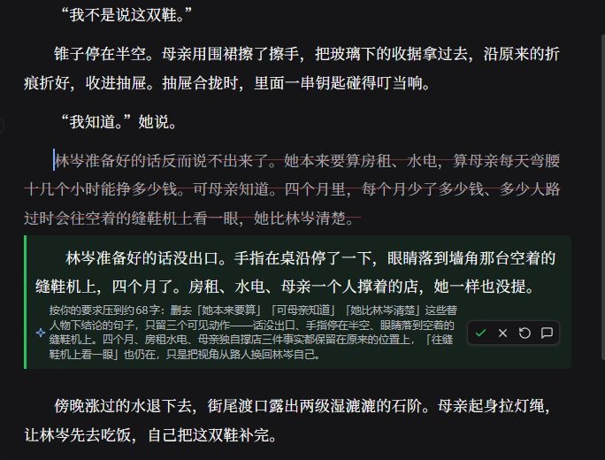
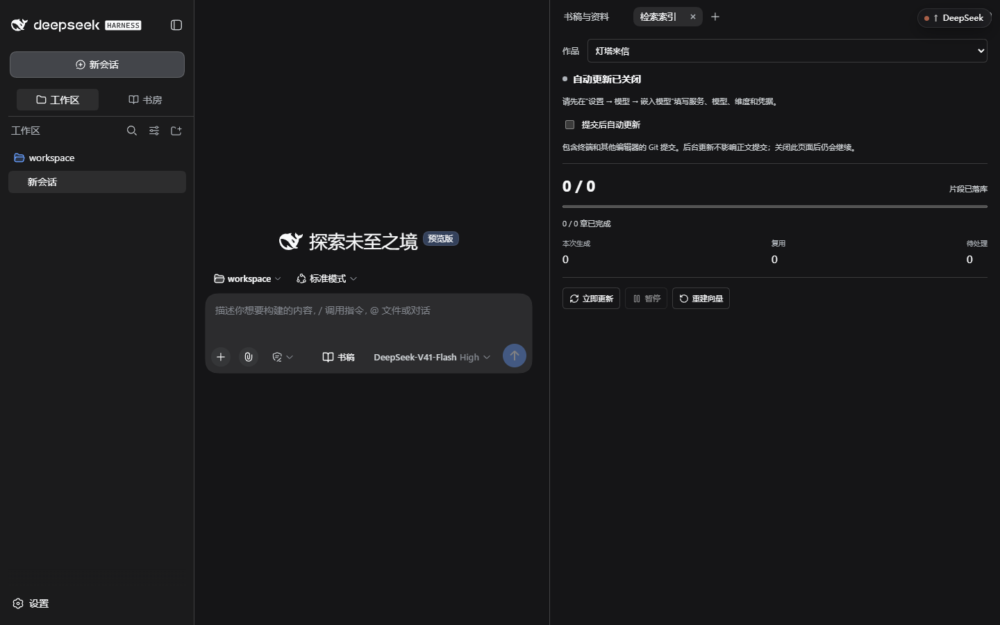

# 新手教程：从安装到日常写作

> [!IMPORTANT]
> Abzu 0.0.45 正式版（配套 DSH 版本见 [安装教程](install.md)）。单包 `abzu` 集成工作台与检索增强。
> 从旧版升级前，先备份。安装和升级的做法见后面的专题文档。

本教程的顺序是：安装运行环境，启动工作台，配置模型，打开工作区，建书，写第一章，然后定稿与恢复；第 11 节起是日常写作与恢复，附录给第一次练习用的合成素材。配套 DSH 版本见 [安装教程](install.md#为什么要固定-dsh-版本)。可以安装精确的 npm 版本，也可以安装对应 Release 的原件。细节见各专题文档。

> [!NOTE]
> 工作台、书房和编辑器截图已于 2026-10-06 更新到 8.2.0。
> 图中《河埠旧事》是原创小说示例，编辑建议与批注来自 DeepSeek 官方 API 的实际调用。其余截图保留历史演示数据，用于定位区域。

> [!CAUTION]
> 升级版本之前先备份。
> 还要 [补充确认作品契约的章节篇幅](upgrade-backup.md#旧项目需要更新作品契约)。升级不会自动填入范围，也不会改写旧章。未配置时仍可使用，但没有篇幅达标判定。版本变化见 [更新记录](../../CHANGELOG.md)。

## 0. 安装摘要：通过插件管理安装

1. 从 [DSH 官网](https://www.deepseek.com/harness/) 安装配套版本的 DSH 客户端（当前对应见 [安装教程](install.md#为什么要固定-dsh-版本)）。
   成功时，桌面端可以打开。
2. 打开侧栏 **插件 → 添加插件**。
3. 输入安装标识：当前从本地构建包安装（`abzu-0.0.45.tgz`，见 [安装指南](install.md)）；公开发布后可从 GitHub Release 下载同名包安装。
4. 核对预览，然后安装。
5. 按页面提示启用、应用变更或重启。
   成功时，已安装列表显示 0.0.45，并且可以打开书房。

检索增强已随主包提供（默认关闭），旧版迁移见 [安装教程](install.md)。不需要在终端里安装插件。

## 1. 先分清五个概念

| 名称 | 是什么 | 你要管的事 |
| --- | --- | --- |
| **DSH**（DeepSeek Harness） | DSH 运行工作台。会话、模型连接、凭据、文件与命令权限都由它负责 | 安装并保持版本一致 |
| **Abzu 插件** | 小说写作工作台本体，以插件形式装进 DSH 的某个 profile | 安装、升级 |
| **profile** | 一份插件组装，例如 `abzu`。不同 profile 的插件与设置互不影响 | 起名字，别和别的 DSH 用途重名 |
| **模型 API** | 你自备的模型服务。聊天是主用途，嵌入／场景识别／重排是三类可选用途 | 填地址、模型标识与密钥，自付费用 |
| **工作区** | 本会话处理作品的目录。实际读写权限由 DSH 的访问模式控制 | 准备一个空目录并备份 |

一本书是工作区下的一个子目录。判断标准是它含有 `作品契约/契约.md`（这本书的总约定文件）。同一个工作区可以放多本书。一个 profile 可以先后服务多个工作区。

## 2. 第一次打开工作区

1. 准备一个专门存放作品的目录。
2. 在 DSH 中新建会话，并选择该工作区。
3. 然后配置主模型。
   成功时，这个会话使用你选中的工作区。

不同工作区里的作品不会自动搬到别处。

> [!NOTE]
> 图中已经打开一个写作会话。
> 新建的空白会话还没有书稿。安装和插件管理以配套 DSH 的当前页面为准（版本见 [安装教程](install.md)）。

## 3. 配置主模型

第一次打开时，会弹出密钥引导。

1. 如果只用官方 DeepSeek 服务，在这个弹窗里粘贴密钥，然后保存并继续。
   成功时，DSH 把密钥放进凭据服务。作品文件里没有这把密钥。
2. 如果使用自建、代理或其他厂商，点「稍后配置」。
3. 打开 **设置 → 模型** 再添加。内置厂商选 **添加提供方**。自建或代理选 **添加自定义提供方**。逐字段的填法和协议示例见 [主模型配置](configuration.md#主模型逐步填写)。

这一页管理两类用途。先只配置第一类，也可以开始写作。

| 用途 | 位置 | 作用 | 是否必须先配 |
| --- | --- | --- | --- |
| **聊天（主模型）** | 页面上方提供方卡片 | 构想、细纲、正文、审读都由它生成 | 是 |
| **增强索引**（检索增强） | 嵌入模型与检索辅助模型分区 | 语义检索等进阶能力（嵌入、场景识别、重排序三件合称） | 否 |

1. 使用服务方给出的**精确模型标识**。不要根据示例名称来猜测。
2. 填写 API 协议、API 地址、密钥，以及至少一个模型 ID。
3. 点 **创建提供方**。如果是在修改已有卡片，则点 **保存**。
4. 关闭设置，并选好工作区。
5. 在输入框底部选择该服务与模型，发送一条短消息。
   成功时，你收到正常回答。然后再开始建书。
6. 第二类是 [增强索引](configuration.md#增强索引操作指南)，可以先整个留空。基础写作不依赖它。

同一页上方还有其他配置分区。常用的是 **通用设置** 里的权限模式、语言、外观与字号。

「权限」决定新会话默认能在工作区里改多少东西。本教程使用默认的「工作区内修改」。「打开配置文件」会打开这个 profile 的配置文件。手工修改之前，请先备份。插件与预设分区见 [界面与按钮参考](ui-reference.md)。

## 4. 打开工作区

1. 点输入框上方的**选择工作区**，然后点「添加工作区…」。
2. 在目录窗口中找到第 2 步准备的目录。
   Windows 通常使用系统原生对话框。下图是演示环境里的应用内备用选择器，样式可能不同。成功时，你选中该目录并点「打开」。

- 如果出现图中的应用内选择器，面包屑右侧的铅笔按钮可以直接键入路径。左侧是当前位置的父级列表。右侧是当前目录的内容。
- 如果出现 Windows 系统对话框，用地址栏定位目录。
- 也可以用选择窗口里的「新建文件夹」，当场建一个目录作为工作区。

打开之后，工作台把该目录当作本会话的工作范围。侧边栏底部会显示当前目录。之后可以用同一个入口切换。

## 5. 建第一本书：灵感收敛与建书

工作台没有「新建作品」按钮。建书在对话里完成。第一次用 [附录的合成练习素材《灯塔来信》](#附录练习素材灯塔来信) 做练习；准备一个空的工作区、可用的主模型，以及少量模型额度。

> [!WARNING]
> 本教程会调用模型，并产生费用。
> 想逐屏对照界面和按钮时，先看 [界面与按钮参考](ui-reference.md)。

1. 把 [合成练习素材](#附录练习素材灯塔来信) 粘进输入框。
2. 发送：

> 按这些素材准备《灯塔来信》。先整理构想七要素给我确认；这是合成练习，一卷三章，先完成第一章。

工作台会先整理构想，并请你确认。

3. 确认构想。
   成功时，工作台创建书仓，书出现在左侧「书房」里，并且能看到书名与文件树。只有一段聊天文字，不代表书已经落盘。

接下来会出现确认点。把它们当作真正需要你判断的地方，而不是过场动画。

- **构想确认**：这本书写给谁、看点是什么，基本盘齐了才允许建书。缺项时工作台会拒绝，这是正常保护。
- **整包设计过目**：先看 5-8 行人话摘要（书写什么、主角是谁、第一卷大概怎么走、关键取舍），说「看细节」或点名某件才展开全文，直接说「同意」即确认整包，同意后写入；想自己细定的块，过目时直接说要改哪块。
- **第一章细纲**：动笔前确认这一章写什么、给读者什么、章尾的钩子放哪。确认之后才进入正文。

> [!NOTE]
> 后面的历史截图中，六章定稿是预置的演示数据。
> 你刚建书时，不会自动得到这些章节。

## 6. 定调与第一章细纲

1. 发送下面的话，走「快速开写」。

> 快速开写，先跑起来再细化。作品契约、人物与世界规则、故事骨架、分卷和卷规划一次起草出来，都要有真实正文，先呈报给我过目，我同意后再逐件写入，不要写只有「已确认」标签的占位设计。近期窗口条目名与第一章章名保持一致，再准备第一章细纲。

这是 0.0.45 的默认路径：工作台一次起草真实设计，给你看过之后再逐件写入。

第一次用就走这条「快速开写」：工作台把这本书的基调、主角设定、故事走向和第一卷计划一次拟好，先用几行人话摘要给你过目（书写什么、主角是谁、第一卷大概怎么走、关键取舍）；想看哪件的全文，点名即可；你说「同意」，它再逐件写入。没想好的地方留白，不勉强填。

进阶——逐部细聊：想在设计期每一步停下来对谈时，改发下面的话。

> 使用逐部设计流程准备开写内容。作品契约、人物与世界规则、故事骨架、分卷和卷规划都要有真实正文，先呈报给我确认，不要写只有「已确认」标签的占位设计。近期窗口条目名与第一章章名保持一致，再准备第一章细纲。

两条路线的产物相同；逐部细聊轮数更多、控制更细。第一次用建议先走快速开写。

如果旧书一直卡在世界构建，按 [旧书模块声明排查](troubleshooting.md#旧书卡在世界构建) 处理。

2. 检查主角、冲突、禁区和章节目标。
3. 需要调整时，直接说明要改的内容。
   成功时，确认后的文件可以在书房里打开。

第一章细纲至少要写清这一章写什么、给读者什么、章尾的钩子放哪。确认之后，才进入正文。

## 7. 写稿、审读与修改

定调时一起约定章节篇幅。例如目标 4000 汉字，宽松范围 3500～4500。按本书的需要来定。把范围写入契约“阅读体验与情绪承诺”的“章节篇幅”子节。旧项目的补法见 [升级指南](upgrade-backup.md#旧项目需要更新作品契约)。

细纲按本章的主要任务分配内容。审读脚本核对实际字数。如果超出范围，按普通发现项处理。工作台不会自动裁稿。

局部修改用 [新编辑器](editor.md) 的选区改写、批注和行内采纳。采纳之后仍然要保存。局部审读不能代替整章审核。

> [!WARNING]
> 不要反复发送“忽略错误继续”。
> 失败时先读具体原因。重复发送修不好这一步，还会继续产生费用。

1. 确认细纲后，发送下面的话。

> 按已确认细纲写完这一章，并继续完成审读和必要修改。涉及定稿或改变故事方向时请给我确认。

工作台可能连续完成本章的内部步骤。它也可能因为模型错误、审核发现，或需要你决定而停下。

2. 如果这一步失败，先阅读具体原因。
3. 修改之后，按实际变化重新核对审核证据。
   成功时，审核证据对得上当前正文。
4. 阅读待审稿，检查修改是否符合你的意图。然后继续第 9 节。

## 8. 读稿、改稿与可视化

1. 在书房里逐级展开「定稿 → 卷01 → 章节」。
2. 点文件名，在右侧打开文档。
   成功时，右侧出现这一章的正文。

- 核对文档标签和路径之后，再直接编辑。选区浮动栏和右键菜单可以改写、续写和审读。详见 [新编辑器教程](editor.md)。
- 定稿正文会提示「定稿更正通过吃书补偿流程处理」。已定稿的内容要改设定或事实时，走补偿流程并留痕。不要随手覆盖。
- “引用到对话”把原文放进输入框。核对之后，由你自己发送。行内建议采纳后，还要用 `Ctrl+S` 保存；三态结果的口径见 [新编辑器教程](editor.md#6-保存和结果核对)。
- 「工作区」标签页同时列出工作区与会话，适合一边看稿一边对话。

「可视化」随会话视图提供。作品视图包括时间线关系图谱和章节进度，用来核对章节推进与时间线落点。展开和刷新按钮见 [界面与按钮参考](ui-reference.md)。

## 9. 定稿、恢复与导出

1. **定稿**：先查看正文、审读结论和准备沉淀的事实，再批准。
   成功时，有定稿文件和对应的版本提交。有获批沉淀时，账本或本书记忆也会变化。不要把“草稿已生成”或“已点击批准”当成“已经定稿”。
2. **恢复**：关闭任务，然后重新打开，发送：

> 继续《灯塔来信》，先核对实际书仓进度，告诉我第一章是否已经定稿。

成功时，工作台根据文件重新校准状态，而不是复述旧结论。

3. **导出**：然后发送：

> 准备卷一已定稿内容的导出合集和来源清单，先告诉我目标目录和冲突情况。

4. 确认目标目录和冲突情况之后，再保存导出。
   成功时，合集只包含指定范围内的定稿。

未写完的章节不会被补成正文。保存之后，检查文件内容和来源清单。导出成品卡的样子与打开方式见 [结果卡与导出成品](result-cards.md)。

这些步骤应当留下可以检查的文件，而不是只留下模型的承诺。

> [!CAUTION]
> 不要把整本书或完整会话贴到公开 Issue。
> 遇到问题时，保存脱敏后的步骤和错误信息，再看 [故障排查](troubleshooting.md)。

## 10. 别把这五件事混为一谈

| 动作 | 实际含义 |
| --- | --- |
| 界面上看到了正文 | 只是打开了一个文件视图 |
| 草稿区里生成了文字 | 还没审读，也还没定稿 |
| 文件已保存 | 磁盘上有内容，尚未成为可信的定稿事实 |
| 作者已确认 | 你表达了认可。仍须对应的确认工具成功执行。不能只凭一句「确认」就判定已提交 |
| Git 已提交 | 留下了版本历史。设计提交和作者修改提交都不等于章节定稿 |

判断进度时，一律回到文件：`定稿/` 目录、账本和版本历史。只有模型承诺、没有文件变化，都算没有完成。

## 11. 日常写作与恢复

日常的操作见 [新编辑器教程](editor.md)；文件卡见 [结果卡与导出成品](result-cards.md)；参考资料见 [参考小说分析](reference-analysis.md)；图谱和流程状态见 [界面参考](ui-reference.md)。

### 继续章节

1. 写明书名和范围。例如“继续这本书的第2章，先核对进度”。
2. 发送给工作台。
   成功时，工作台读取实际书仓，再决定要准备细纲、写稿、审读还是定稿。

换会话时，不需要手工重建一份当前章节状态表。

### 修改设计或正文

保存文件、提交版本、工作台理解修改，这是三件不同的事。

1. 在书房编辑器里保存草稿、规划或世界书。
2. 让工作台核对影响。
   如果保存时报告版本冲突，先重新读取当前文件，避免覆盖更新。

在当前主会话打开书房并保存之后，按 [新编辑器教程](editor.md#6-保存和结果核对) 核对保存三态结果（文件已保存／版本已提交／已交给主控）。

如果只有标点或局部措辞变化，核对之后可以直接结束。如果改变了事实、人物目标或写作约束，说明受影响的内容和等你决定的事项。工作台不会因此自动重写下游，也不会推进下一章。

如果在外部编辑器或终端里改了文件，这次修改没有经过书房的保存通知。

1. 回到对应作品的对话。
2. 可以直接说：

> 我刚修改了《书名》的作品契约，把主角目标从复仇改为寻找真相。请读取当前文件，核对大纲、世界书和已定稿章节的影响，列出需要调整的地方，先不要改稿。

不需要专门的隐藏命令。“刷新书房”会同步目录和已打开的正文。有未保存的编辑时，它保留文字并提示比较。它不能代替上面这条核对请求。

主控忙碌或被中断之后，也可以说明文件和改动目的，请它从当前文件重新核对。不要为了唤醒它而反复保存相同内容。

修改未定稿内容时，可以返回相关流程。涉及已有定稿的设定变化，要核对影响，并走补偿或修订流程。不要直接改已确认的设计文件，也不要手写账本来绕过检查。

### 审核失败或模型中断

1. 先看失败来自哪里：正文问题、材料不足、配置或网络，还是你的意见。
2. 补足材料，或修好服务。
3. 继续对应的步骤。
   成功时，你能看到实际的审核记录或提交结果。

模型输出的一句“完成”，不能代替审核记录或提交结果。

### 暂停

1. 明确要求暂停当前章。
   成功时，当前章停止继续写入。
2. 下次开始时，先核对文件和 Git 状态。
   已完成的部分可以继续使用。取消或失败不是对后续写入的批准。

暂停期间，不要在别处手工改动同一章的文件。

### 卷末

1. 先核对计划章节、定稿和未回收事项。
2. 准备卷摘要候选。
3. 核对之后再确认。
   成功时，卷摘要与已核对的定稿一致。

窗口用尽，不等于整卷完成。无法确定时，应显示未知或待核对。开始下一卷之前，核实前卷沉淀和当前卷规划。

### 导出

导出在 [第 9 节](#9-定稿恢复与导出) 已讲：指定范围和新目标目录，先查冲突，再保存定稿合集与来源清单，成品卡见 [结果卡与导出成品](result-cards.md)。导出不会把草稿混进定稿。平台上的排版和发布仍由你自己检查。工作台不会代你向小说平台投稿。

## 12. 卡住了先看这里

| 现象 | 常见原因 | 处理 |
| --- | --- | --- |
| `dsh --profile abzu --dump-config` 里没有 `id: abzu` | 插件没装进这个 profile，或装到了别的 profile | 重新执行 `dsh plugin --profile abzu add ...` |
| 页面打不开或提示重新打开链接 | 用了不带 token 的地址，或换了终端重启 | 重新复制当次启动打印的完整链接 |
| 发消息没有正常回答 | 主模型未配置、模型标识不对、额度或速率受限 | 到设置 → 模型核对并试通一条短消息 |
| 书房提示「请在当前主会话中打开书房」 | 当前是未开始的新会话 | 先选择工作区打开，或从会话列表进入已有会话 |
| 建书被拒绝 | 构想未确认或要素不完整 | 补齐七要素并明确确认 |

更多现象和处理见 [故障排查](troubleshooting.md)。备份、升级与卸载见 [备份与升级](upgrade-backup.md)。检索相关的数据流与费用见 [隐私与费用](privacy.md)。

## 附录：练习素材《灯塔来信》

这是为安装与教程编写的虚构素材，按项目许可证提供，不含真实作品或人物资料。

| 项目 | 练习内容 |
| --- | --- |
| 核心创意 | 海岛邮差收到一封由废弃灯塔寄出的明日来信 |
| 题材与目标读者 | 温和悬疑、短篇练习，适合第一次使用工作台 |
| 主角核心欲望 | 在暴风雨到来前找到失联的灯塔管理员 |
| 主要冲突 | 港口封闭，镇民对灯塔的说法互相矛盾 |
| 核心看点 | 来信中的小细节逐步兑现，答案来自可验证线索 |
| 差异化方向 | 以投递路线组织场景，重视人物选择而非超能力 |
| 明确不要什么 | 不写血腥暴力，不增加穿越解释，不用梦境收尾 |

练习范围：一卷三章；第一章发现来信、核对邮戳并决定去灯塔，章尾留下“邮戳时间为何晚于今天”的悬念。先完成一个短章，再决定是否继续。数字与章节长度是练习偏好，不代表性能或费用承诺。
