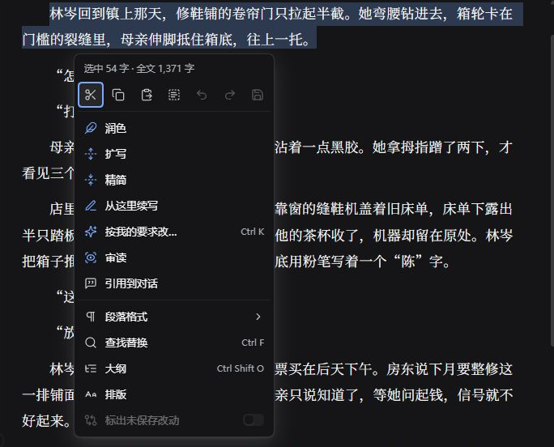
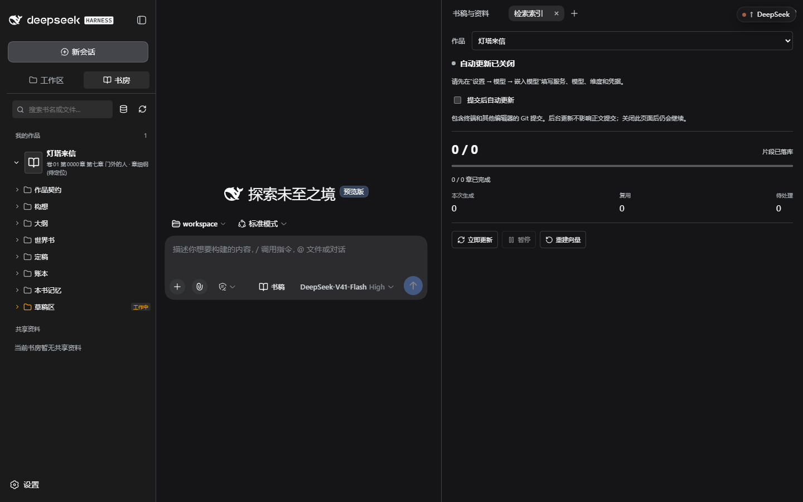
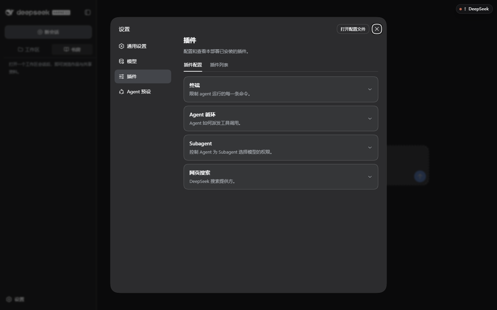
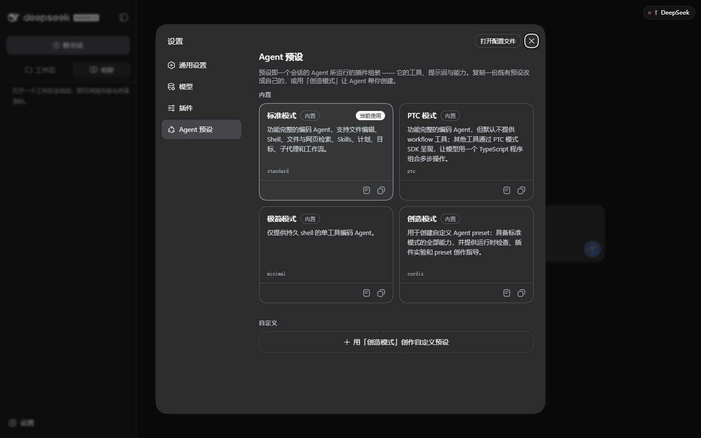

# 界面与按钮参考

这一页说明 Abzu 0.0.46 的界面元素（配套 DSH 版本见 [安装教程](install.md)）。工作台和编辑器截图使用原创示例《河埠旧事》，于 2026-10-06 在当前 Web 端拍摄。其他历史演示截图用于定位区域，按钮以当前界面为准。

## 主界面分区

| 区域 | 位置 | 作用 |
| --- | --- | --- |
| 导航栏 | 最左 | 新会话、工作区／书房切换、会话搜索、设置入口 |
| 对话区 | 中间 | 与 Agent 的会话；输入框在底部 |
| 右侧面板 | 右侧（随会话打开） | 书稿与资料、检索索引等文档与状态面板 |

底部一行显示当前会话的工作目录。鼠标悬停时，可以看到完整路径。实际能访问的范围，还取决于 DSH 的访问模式。

## 左侧导航

| 元素 | 用途 | 使用时机 |
| --- | --- | --- |
| **新会话** | 开一个空白会话 | 换任务或换书时；旧会话仍在列表里 |
| **收起侧边栏** / 展开按钮 | 让出横向空间给正文 | 对照长文或看可视化时 |
| **工作区** 标签 | 列出工作区与会话 | 在多个会话间跳转 |
| **书房** 标签 | 浏览作品与共享资料 | 读稿、找文件、看作品状态 |
| **搜索会话…** | 按标题过滤会话 | 会话变多后定位 |
| **设置** | 打开设置对话框 | 配置模型、权限、外观、插件、预设 |

书稿文档标签页和「书稿与资料」面板标题上的 ● 表示有未保存的编辑内容；不要据此推断会话列表中其他状态标记的含义。

## 输入框与按钮

| 元素 | 用途 | 说明 |
| --- | --- | --- |
| **工作区选择器** | 选择／切换本会话的工作目录 | 首次使用必须显式选择，工作台不会默认接管任意目录 |
| **模式（标准模式等）** | 选择 Agent 预设 | 预设决定工具与提示词；默认标准模式即可写作 |
| **+** | 添加附件到当前消息 | 图片、文本、日志 |
| **指令（/）** | 调出指令菜单 | 会话控制类命令 |
| **访问模式（工作区内修改）** | 当前沙箱权限档位 | 决定 Agent 能在工作区里做多少改动；调宽前先确认影响范围 |
| **书稿** | 打开右侧「书稿与资料」面板 | 需要一边看正文一边对话时 |
| **模型选择器** | 当前主模型与推理等级 | 只影响本会话；请在设置 → 模型中先把服务配好 |
| **发送** | 提交消息（忙碌时按设置排队或打断） | 见「通用设置 → 繁忙时的发送行为」 |

## 书稿与资料（右侧面板）

| 元素 | 用途 |
| --- | --- |
| 文档标签页 | 一个文档一个标签，● 表示有未保存修改 |
| 书名 / 相对路径 | 明确这段正文属于哪本书的哪个文件 |
| 稿件版本 | 查看稿N文件名及保存结果中的版本信息，核对是否打开当前稿 |
| 正文与选区浮动栏 | 可编辑文件直接修改，选区可发起改写、审读及引用 |
| 右键菜单 | 润色、扩写、精简、续写、按要求改、排版与保存 |
| 行内建议／批注 | 核对后采纳或拒绝；局部审读不等于整章审核完成 |
| 「定稿更正通过吃书补偿流程处理」 | 已定稿正文的事实性修改要走补偿流程留痕 |
| **引用到对话** | 把当前内容作为引用交给 Agent |
| **全文计数** | 当前编辑内容的字符计数，含标点和可能存在的候选事实，不同于脚本正文汉字数 |
| **保存** | Ctrl+S 或菜单保存；三态结果核对见 [新编辑器教程](editor.md#6-保存和结果核对) |

旧版三模式已替换。完整操作及取消、采纳、保存说明见 [新编辑器教程](editor.md)。

可编辑文件适合直接改错别字、行文小修；**定稿正文只读，即使是错字也通过吃书补偿流程处理**。改变设定、事实或章节结构请回到对话里说清楚，让工作流留下相应记录。

## 书房

| 元素 | 用途 |
| --- | --- |
| **搜索书名或文件** | 在作品与文件树里定位条目 |
| **查看检索索引** | 打开「检索索引」面板（见 [增强索引·在书里运行索引](configuration.md#在书里运行索引)） |
| **刷新书房** | 重新扫描工作区；在终端或外部编辑器改过文件后用 |
| **我的作品** | 作品卡片列表；卡片副标题给出卷章进度或需要处理的提示 |
| **文件树** | 作品契约／构想／大纲／世界书／定稿／账本／本书记忆／草稿区，逐级展开到文件 |
| **共享资料** | 工作区级别的共享文件，不属于某一本书 |
| 底部路径 | 当前工作区根目录 |

草稿区右侧的「工作中」徽标表示草稿区尚有进行中的内容，不代表已定稿。

## 工作区标签页

列出工作区与其下的会话，用于在工作区之间切换、回到旧会话。与书房可以并存：左侧看会话、右侧看稿。

## 统一文件标签与自动刷新

书房目录和对话中的书稿链接，进入 DSH 的原生文件标签。文件图标、标签栏、分栏和打开方式由 DSH 提供。书房范围内的书稿和共享资料使用新的直接编辑界面，支持选区改写、行内建议、批注、保存和引用。书房范围外的普通文件、演示导出合集和 PDF，继续使用原生预览。同一个文件反复打开时会复用标签。草稿保存生成新版本时，当前标签跟随到新稿。

新界面的具体操作见 [编辑器教程](editor.md)。

目录监听当前工作范围和已经展开的目录。新增或删除文件之后，目录会自动更新。重新展开目录也会读取最新列表。正在打开的正文发生外部变化时：

- 没有未保存的修改：自动更新正文。
- 有未保存的修改：保留你的文字，并提示“磁盘内容已变化”。比较之后，可以载入磁盘版本，或保留编辑。
- 保存正在进行，或结果尚未确认：不覆盖缓冲。先完成原来的保存，或重试原来的保存。

“刷新书房”现在同时重读目录和已打开的正文，并沿用上面的保护。原生文件标签的重新读取也会更新书稿。目录监听不可用时，会提示你手动刷新。

关闭原生标签，会保留当前会话内的编辑缓冲。再次打开文件可以继续。未保存的修改显示圆点。退出页面时仍会提醒。缓冲不等于已经保存到磁盘。不能靠它在应用重启之后保留内容。

> [!NOTE]
> 外部变动只更新界面，不向主控发送通知。
> 是否增加这个能力，尚未决定。在书房里主动保存之后，现有通知保持不变。

## 可视化

会话视图里的「可视化」提供三个视图：

- **写作流程**：在创作全图里按章节筛选。可以查看本会话正在执行、等待确认或已经结束的操作。点击节点可以查看记录。“回到当前”定位正在执行的步骤。全屏时仍能打开节点详情。
- **人物关系**：用不同形状区分人物、组织、地点、事件和线索。可以按章节回看，并筛选已披露记录、计划和未标注时间的资料。搜索条目之后，可以查看直接关联、更多关联和两点路径。实线表示关系。虚线箭头表示引用。滚轮可以缩放。拖动可以移动画布或节点。“查看全图”用来归位。全屏时仍可查看详情。选中条目后，可以看历史和关联记录，并打开原文。也可以用“选择图谱记录”下拉框操作。
- **章节进度**：按卷、状态和章名查找，查看实际的定稿情况。

面板顶部可**选择可视化作品**、**刷新作品视图**；没有可用作品时会提示「当前工作范围暂无作品。」。适合在写卷中段核对「哪些章已定稿、哪些线索还没回收」。它只读，不会改动书稿。

流程节点依据工具记录显示，不会自动执行下一步。“操作完成”只表示一次调用完成，不代表整章完成；通用操作无法确定工序时显示“处理中”。失去连接后显示提示，恢复连接再核对状态。

“作者裁决”标记实际待答，答复后入档操作显示在“定稿入档”；“本章完成”的已定稿标记来自章节资料。选择某一章后，当前动作、节点和历史记录都只显示这一章。

## 检索索引（右侧面板）

列出当前书的索引进度、暂停／重试与错误信息。逐项说明见 [增强索引操作指南](configuration.md#增强索引操作指南)。

## 设置

| 分区 | 内容 | 说明 |
| --- | --- | --- |
| **通用设置** | 权限、语言、外观、字号大小、对话显示、繁忙时的发送行为 | 只改新会话默认值或显示偏好，不改作品文件 |
| **模型** | 提供方卡片、嵌入模型、检索辅助模型 | 见 [模型配置](configuration.md)（含 [增强索引](configuration.md#增强索引操作指南)） |
| **插件** | 插件配置／插件列表 | 查看本部署已安装的插件与其可调项 |
| **Agent 预设** | 内置标准／PTC／极简／创造模式，可查看、复制、设为默认 | 预设决定工具与提示词；不确定就保持标准模式 |

「打开配置文件」直接打开该 profile 的配置文件；手工编辑前先备份，并在改完后重新启动工作台确认加载成功。

## 状态与徽标速查

| 显示 | 含义 |
| --- | --- |
| 标签页上的 ● | 有未保存的编辑内容 |
| 文件树「工作中」 | 草稿区仍有进行中的内容 |
| 作品卡片副标题 | 当前卷的进度或需要核对的提示（例如近期窗口没有可进入条目） |
| 检索索引状态行 | 见 [增强索引状态表](configuration.md#状态表) |
| 输入框右侧模型名 | 本会话使用的主模型与推理等级 |
